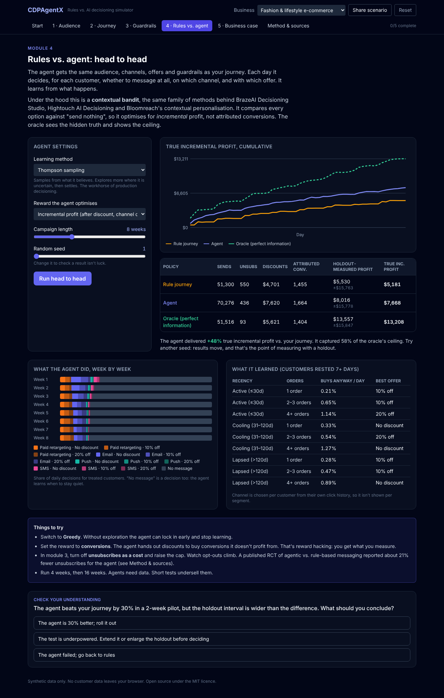

# CDPAgentX

**A vendor-neutral flight simulator for AI decisioning.** See how a rule-based CDP journey compares with a learning agent on the same customers, and measure both the way a real team would: against a holdout.



## What's inside

| Module | You learn |
|---|---|
| 1 · Audience | What RFM rules can and can't see; look-alike expansion; "would buy anyway" customers |
| 2 · Journey | Build a weekly rule journey. Read it three ways: attributed, holdout-measured (with a 95% interval), and true incremental |
| 3 · Guardrails | Frequency caps, discount ceilings, banned-word copy checks, holdout size, unsubscribe cost, and a cap sweep for rules vs. agent |
| 4 · Rules vs. agent | Contextual Thompson-sampling agent vs. your journey vs. a perfect-information oracle. Explore/exploit, reward hacking, learning curves |
| 5 · Business case | Your own base size, AOV, margin, consent and tool cost give a simulated range, payback, and a Markdown or print export |
| Method & sources | Every parameter next to a published benchmark, plus assumptions and simplifications |

Every setting is encoded in the **Share scenario** link, so a workshop can start everyone from the same place. All data is synthetic and nothing leaves the browser.

## How the simulation works

`src/engine/` is plain JavaScript with no React. It is unit-tested and runs in a Web Worker.

- `population.js`: synthetic customers. Each has observable fields (recency, frequency, monetary, consent, click history) and hidden traits (purchase rate, channel affinity, persuadability, deal-seeking, fatigue tolerance).
- `simulate.js`: day-by-day campaign simulation with three policies (rules, agent, oracle), guardrails, holdout, and true-incremental measurement via common random numbers against a do-nothing run.
- `channels.js`: channel parameters and the cited `BENCHMARKS` list.

See [docs/STRATEGY.md](./docs/STRATEGY.md) for positioning, roadmap and monetisation options.

## Development

Requires Node.js 18 or later.

```bash
npm install
npm run dev        # local dev server
npm test           # engine tests
npm run build      # production build
node scripts/calibrate.mjs 10000 56   # compare policies from the command line when tuning the model
```

Pushing to `main` runs the tests, builds, and deploys to GitHub Pages (`gh-pages` branch): https://pawa80.github.io/CDPAgentX/

## Contributing

Contributions are welcome, especially better-sourced benchmarks and new scenarios. Fork, branch, and open a pull request that explains the change.
